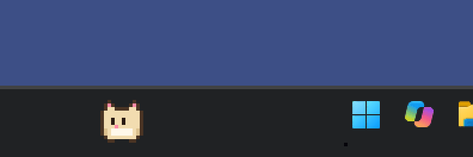

  

<h1 align="center">Desk Buddy</h1>

  <b>A tiny pixel cat that lives on your Windows taskbar.</b> 
  It wanders between your icons, naps, chases mice, knocks things off, and plays little games with you.

  <a href="https://github.com/nightwingfk1/desk-buddy-releases/releases/latest/download/DeskBuddy.exe"><b>⬇ Download DeskBuddy.exe</b></a>
  &nbsp;·&nbsp; Windows 10 / 11 &nbsp;·&nbsp; free &nbsp;·&nbsp; about 61 MB &nbsp;·&nbsp; no installer

---

## What it does

- **Lives on your taskbar.** It walks the whole width of it on a fully see-through window, sniffs and bats at your
  icons (they wobble), perches on them and naps beside them. Only the cat itself catches your clicks: everything
  around it clicks through to whatever is underneath.
- **You adopt it.** On the first start you pick a kitten at a little shelter, give it a name, and it arrives on your
  taskbar in a carrier box.
- **Play with it.** Click to pat it, drag to pick it up and throw it, double-click and it picks a fight with your
  cursor. Throw it a ball and it brings it back. Draw shapes with your cursor above it and it learns tricks.
- **It's a cat.** It knocks a mug off an icon while looking you in the eye, gets the zoomies, naps in a patch of
  sunlight, sleeps in silly positions, lies on top of your clock, and slow-blinks at you.
- **Visitors.** Now and then a friend drops by to play, and a mouse tears a hole in your taskbar and the chase is on.
  Very, very rarely, a UFO comes for it.
- **Mini-games and a shop.** Three 30-60 second games (a runner, a stacker and a reflex game) in a small strip above
  the taskbar. Coins buy hats, coats, furniture it lives with (a bed, a fish tank, a box to hide in...) and gear
  (a greatsword, a katana, an umbrella).
- **Keeps you company while you work.** A focus timer (15, 25 or 50 minutes) where it sits quietly by an hourglass,
  then holds up a BREAK! sign. It dances when music plays and pants when your PC is working hard.
- **Follows the calendar.** Halloween, Diwali, Holi, Christmas and New Year, Ramzan, Eid and Bakri Eid, its adoption
  day and your birthday, each with decorations and a limited hat. Optional Salah (prayer) reminders.
- **More than one screen?** Its world can span all your side-by-side taskbars, and it jumps across the gap between them.

  

## Getting started

1. [Download **DeskBuddy.exe**](https://github.com/nightwingfk1/desk-buddy-releases/releases/latest/download/DeskBuddy.exe)
   and put it wherever you like (your Desktop or Documents is fine).
2. Double-click it. There's nothing to install.
3. **Windows may warn you** ("Windows protected your PC") because the app isn't signed yet. Click
   **More info → Run anyway**. If **Smart App Control** is on, Windows may block it with no way past the warning;
   that's a limit of unsigned apps, sorry.
4. Adopt your kitten, then **right-click it** for the menu: games, the shop, the focus timer, settings.

Handy to know:

| | |
|---|---|
| **Click** | a pat |
| **Double-click** | it fights your cursor (**Esc** ends it) |
| **Drag** | pick it up; let go while moving to throw it |
| **Right-click** | the menu |
| **Ctrl + Alt + G** | hide it / bring it back |
| **Esc** in a game | boss key: the game vanishes instantly |

Settings → **Start at login** makes it turn up every time you start your PC.

## Privacy

Everything stays on your PC: **no accounts, no ads, no telemetry**.

- It never goes online unless you ask it to check for updates (off by default).
- To dance it reads only **how loud** your speakers are, never what's playing.
- It notices **that** a key was pressed (to react to typing), never which key.
- It looks at the taskbar's pixels to find your icons; those pictures stay in memory and are never saved.
- Your progress is one file on your PC: `%APPDATA%\DeskBuddy\save.json`.

## Updating

**Settings → Check for updates…** downloads the newest version from this page, checks it against its published
SHA-256 checksum and restarts. Your cat, coins and everything else stay. You can also turn on
**Check for updates daily**. Or update by hand: quit Desk Buddy from its menu, replace `DeskBuddy.exe` with the new one,
start it.

## Uninstall

Turn off **Start at login**, choose **Quit** from the menu, delete `DeskBuddy.exe`, and delete the
`%APPDATA%\DeskBuddy` folder.

## Feedback

Found a bug or have an idea? Open an [issue](https://github.com/nightwingfk1/desk-buddy-releases/issues) or say hi in
[Discussions](https://github.com/nightwingfk1/desk-buddy-releases/discussions).

---

Every release's `DeskBuddy.exe.sha256` holds the file's SHA-256 checksum. The Salah reminders' city list is
from <a href="https://www.geonames.org">GeoNames</a> (CC BY 4.0). macOS isn't supported yet.
